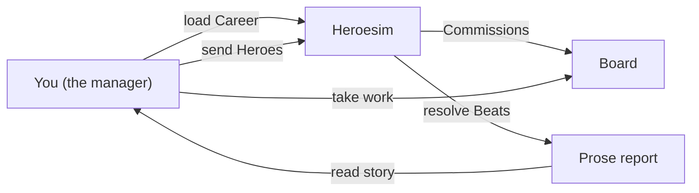

# Heroesim — Documentation

**Heroesim** is a guild-management simulation for the terminal: you run a Guild of heroes, take paid work from Patrons, choose who to send, and read what happened to them. The output that matters is the story, not the score.

**Status:** all eight epics are built and independently verified, as of 2026-09-20 (DL-13 to
DL-28). E8's S1–S5 were verified on 2026-09-19 and **E8-S6, the three earlier acceptance boxes
that were still open and E8's definition of done were independently verified on 2026-09-20**;
that round found and fixed nine defects and gaps — among them an ended Career's header stating an Upkeep that will
never fall due and a Board that will never refresh, the Waiting-on-your-word pane still offered
on an ended Career that stopped with a Party mid-Commission (reachable on 9 of 60 sampled seeds),
ten identifier fallbacks that could put an engine id in front of the player, and a retired
Hero's exit read out twice — and raised design questions for the owner which are listed in
[E8 §6](epics/E8-web-front-end.md#6-what-independent-verification-raised-for-the-owner). The
figures, measured at the end of that verification: **1,629 Vitest tests passed and 5 skipped
across 91 files** (89 passed, 2 skipped) over engine, content, narrate, cli and web, in about
180 s; **141 Playwright checks at mobile, tablet and desktop, all on Chromium** — 47 per
project, against the built bundle; **109 screenshots** kept as evidence under
`docs/verification/`. `npm run typecheck` is clean and `npm run lint` reports 0 errors (1
pre-existing warning). All of it was re-run from a **clean copy of the tree with `npm ci`**,
outside the repository, and passed there too.

---

## The documents

Read in order. Each builds on the one before.

| # | Document | Purpose |
| --- | --- | --- |
| — | **[CONTEXT](../CONTEXT.md)** | Vocabulary, naming conventions, and the words *not* to use — binding reference |
| — | **[Design](../design.md)** | Complete game design: loop, people, work, Rivals, Career, what we are deliberately not doing |
| — | **[ADRs](../adr/)** | Eight architecture decisions (engine as library, events-not-prose, Traits-as-currency, Vignettes, Beats, Guildmaster-never-joins, Rivals-unsimulated, snapshots-not-replay) |
| 00 | **[Decision log](00-decision-log.md)** | Build-time decisions (DL-nn), appended before implementation; supersede, never edit |
| 03 | **[Solution architecture](03-solution-architecture.md)** | The engine contract: packages, state shapes, content format, rules, API, events, saves, verification |
| — | **[Implementation Plan](epics/README.md)** | **Eight epics (E1–E8), vertical slices delivering a playable game after each; E8 is the web front end (DL-01)** |

---

## What's already decided

| | |
| --- | --- |
| **Story** | Guild management, not role-playing. You never control a Hero directly; you stay in the hall |
| **Winning** | There is no high score. Retirement ends a Career well; Insolvency ends it badly. Story is the thing |
| **Audience** | One player, single-player, local saves, no multiplayer or accounts |
| **Build** | TypeScript on Node 22+; engine (pure library) + CLI (terminal front end) + web client (React, DL-01). Vitest for testing; Playwright on Chromium for browser verification (DL-04) |
| **Tech stack** | No external services. No API keys. No hosting. Runs entirely locally |
| **Costs** | Zero running cost forever (NFR-level requirement) |

---

## Where to start reading

| If you want to know… | Read |
| --- | --- |
| **What gets built, in what order** | **[Epics: README.md](epics/README.md)** — the implementation plan |
| **How to get started on E1** | **[Epics: E1-core-loop.md](epics/E1-core-loop.md)** — eight stories, acceptance criteria, technical setup |
| **What inputs you need to provide, and when** | [Epics: INPUTS-REQUIRED.md](epics/INPUTS-REQUIRED.md) — every decision, all with defaults |
| **One-page summary of the plan** | [Epics: EXECUTIVE-SUMMARY.md](epics/EXECUTIVE-SUMMARY.md) — what/when/why, and how it differs from FPL DOF |
| **What the game is, from the ground up** | [Design](../design.md) — 2.2k words, complete |
| **Every rule and term explained** | [CONTEXT](../CONTEXT.md) — Guild, Guildmaster, Hero, Regard, Commission, Beat, Vignette, etc. |
| **Why each hard decision was made** | [ADRs](../adr/) — eight short documents, one per decision |

---

## The shape of it

That is the loop: take work, send Heroes, read what happened. No server, no clock, no external services. All of it runs locally.

---

## Decisions in force

| | |
| --- | --- |
| **Engine** | Pure TypeScript library: no files, no global RNG, no clock. Randomness and time are injected (ADR-0001) |
| **Events** | Engine emits structured events (`PartyCommitted`, `BeatResolved`, etc.), not prose. CLI turns events into English (ADR-0002) |
| **Character** | Traits are the universal currency: Backgrounds, Injuries, Scars, and dispositions are all Traits (ADR-0005) |
| **Beats** | Commissions resolve as sequences of Beats (short incidents), each settled by a Check and narrated as ~one paragraph (ADR-0006). No tactical combat system |
| **Vignettes** | Beats come from authored templates with slots, not random generation. Story quality comes from specificity to the people involved (ADR-0008) |
| **Guildmaster** | The player's character in the world (with Stats, Traits, Regard), but never joins a Party. Stays in the hall, gives Backing (ADR-0007) |
| **Rivals** | Other Guilds exist; they take work you don't and their Heroes can be Transferred or Poached. But they do not run Beats — they are not fully simulated (design constraint) |
| **Saves** | State snapshots, not event logs. Load/save the Career directly (ADR-0004), so saves stay robust through rule changes |
| **Epics** | Seven vertical slices, each leaving a playable game. Narrative coherence gates work, not calendar (no deadline pressure) |

---

## Open questions (nothing blocking the start)

These will be decided **before each epic**, not before work starts. All have sensible defaults.

| When | Question | Default | Where |
| --- | --- | --- | --- |
| Before E1 | Save format: JSON, TOML, plain text? | JSON — decided, DL-02 | INPUTS-REQUIRED §1.3 |
| Mid-E1 | Career length (years)? | 20 years — adopted, DL-06 | INPUTS-REQUIRED §2.1 |
| Mid-E1 | Board refresh rate? | Every 10 days — adopted, DL-06 | INPUTS-REQUIRED §2.2 |
| Mid-E1 | Upkeep amount? | 88 coin per 10 days for four Heroes — adjusted after measured play, DL-13 | INPUTS-REQUIRED §2.3 |
| Mid-E1 | Vignette authoring format? | TOML — decided, DL-03 | INPUTS-REQUIRED §2.11 |
| Before E2 | Regard decay rate, insistence cost? | −1/30 idle days; −2 + risk — adopted and built, DL-14 | INPUTS-REQUIRED §3 |
| Before E3 | Injury duration, Hall costs? | 15–30 days; 200 coin | INPUTS-REQUIRED §4 |
| Before E4 | Applicant frequency, Standing gates? | Every 20 Days, 10 below the Roster floor; Standing gates calibre and nothing else — adopted and built, DL-19 | INPUTS-REQUIRED §5 |
| Before E5 | Rival count, Transfer fees, Poaching cost? | 4–6 Rivals; 100+50×calibre | INPUTS-REQUIRED §6 |

**None of these block the start of E1.** You can build with the defaults and tune after playing.

---

## How this is different from FPL DOF

The heroesim planning uses the **same discipline** (epics, stories, definition of done, decision log) but applies it differently:

| | FPL DOF | Heroesim |
|---|---------|----------|
| **Deadline** | GW1: 21 Aug 2026 (immovable) | None — narrative coherence gates work |
| **Scope** | Large system (38 gameweeks, live operation) | Small system (one playthrough, finite Career) |
| **Build pattern** | Horizontal layers (data → model → web UI) | Vertical slices (each epic is playable end-to-end) |
| **Inputs** | Many (API keys, config, FPL team ID) | Almost none initially (all have defaults) |
| **External deps** | FPL API, odds APIs, GitHub hosting | None — pure local engine |
| **Users** | Single user, but with league and team IDs | Single player, local saves only |
| **Estimated build time** | ~60 focused days to GW15 | ~25–31 focused days to polish (no rush) |
| **Paced by** | Calendar and deadline pressure | Playing Careers and seeing what feels right |

**Both are committed to the same quality bar:** each epic lands with working code, tests, documentation, and a decision log entry for any hard choice. The difference is that FPL is high-pressure sprint, and heroesim is low-pressure craft.

---

## Next step

1. **Read** the [implementation plan](epics/README.md) and [E1 epic spec](epics/E1-core-loop.md)
2. **Confirm** the plan makes sense, or ask for changes
3. **Build** when ready — no blocking inputs

The full spec is ready. Implementation begins whenever you want.
