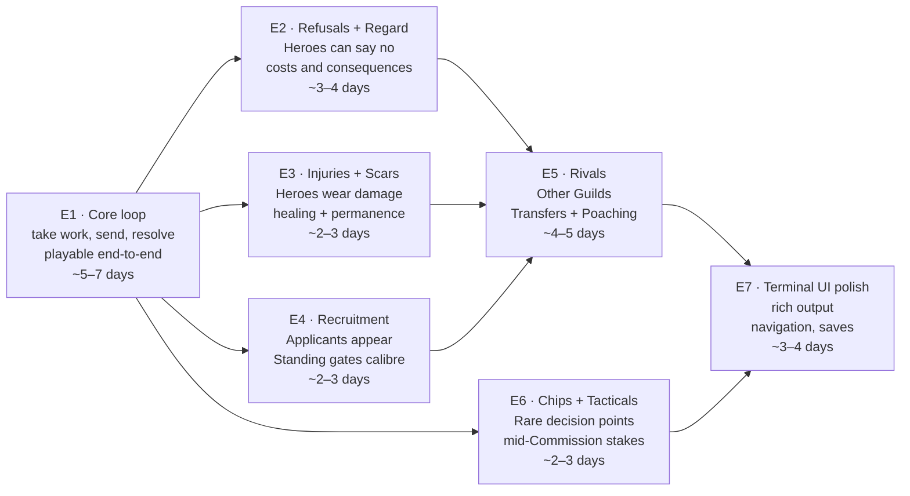

# Implementation Plan — Epics

**Companion to:** the [planning set](../README.md) · **Baselined:** 2026-09-19  
**Master clock:** Narrative completion, not calendar gates  
**Build model:** Vertical slices with playable output after each slice

---

## 1. The shape of this plan

The build is organised as **vertical slices**, each delivering complete, playable simulation end-to-end. This differs from a feature backlog because it prioritises *working game* before polish: a slice landing means the player can load a Career, make decisions, and see consequences, even if later slices will widen what "consequence" means.

The first slice (E1) delivers the core simulation loop: take Commissions, send Parties, resolve Beats, and see what happened. Subsequent slices extend the branching logic (what refusals look like), widen the consequence set (injuries, scars, recruitment), and build out the front end.

Unlike a deadline-driven build (FPL's GW1 constraint), heroesim is paced by narrative coherence: the stories must make sense before they scale, and the rules must remain legible. **No epic should be rushed to hit an arbitrary date; each should start when its dependencies are coherent and all acceptance criteria are understood.**

---

## 2. Epic register

| ID | Epic | Objective | Narrative scope | Est. | Dependencies |
| --- | --- | --- | --- | --- | --- |
| [**E1**](E1-core-loop.md) | **Core simulation loop** | **First playable Career** | Take Commissions, send Parties, resolve Beats end-to-end | **5–7 d** | None |
| [E2](E2-refusals-and-regard.md) | Refusals and Regard | Heroes say no; relationships matter | Low Regard, Trait-based refusals, insistence costs | 3–4 d | E1 |
| [E3](E3-injuries-and-scars.md) | Injuries and Scars | Heroes wear history | Injuries that heal, Scars that stay, Hall improvements | 2–3 d | E1 |
| [E4](E4-recruitment.md) | Recruitment | Roster grows | Applicants, Standing gates, onboarding decisions | 2–3 d | E1 |
| [E5](E5-rivals.md) | Rivals and the League | Other Guilds | Transfers, Poaching, Rival Roster churn, League view | 4–5 d | E2 + E3 + E4 |
| [E6](E6-chips-and-tacticals.md) | Chips and Tacticals | Mid-Commission stakes | Rare decision points where a Party sends word | 2–3 d | E1 |
| [E7](E7-terminal-ui-and-saves.md) | Terminal UI and Saves | Playable end to end | Navigation, career logs, graceful exit, rich output | 3–4 d | E5 + E6 |

**Total build: 21–31 focused days**, against no calendar deadline.

---

## 3. Sequencing rationale

**Why E1 is first and gates everything.** A playable Career is the baseline against which all later systems are tested. Trying to build Regard systems into a non-working loop is how you end up with six weeks of debugging before you get to test the thing you're actually building. E1 lands with Commissions, Parties, and Beats working; every later epic assumes that works.

**Why E2–E4 can run in parallel after E1, and then E5 merges them.** Refusals, Injuries, and Recruitment are three orthogonal dimensions of "what can go wrong"; the core loop needs none of them to be playable. Once the loop works, build these in whichever order makes sense for narrative clarity. Then E5 converges them: Rivals only make sense when Regard is built (E2), Heroes age out (E3), and new ones can be recruited (E4).

**Why E6 (Chips) is independent of Regards but sits before E7.** Chips represent rare moments where the player's attention snaps back mid-Commission — the equivalent of a mid-gameweek news event in FPL. They work independently of whether Heroes like or dislike each other. They belong in the terminal UI (E7) because they affect what the player sees.

**Why E7 is last.** The terminal UI is where everything converges: saves must persist Regard, Injuries, Scars, Rivals, and Chip state. A terminal UI that speaks to a game-in-progress is clearer than one built before the game exists.

---

## 4. What you need to provide — inputs and environment

### Before work starts

| Input | Why | Blocking? |
| --- | --- | --- |
| **Confirm Node 22+** | Baseline for `typescript`, `vitest`, CLI tooling. Local: `node --version` | No — fallback to 25+ |
| **npm or yarn** | Package manager. Local: `npm --version` | No — npm is preinstalled |
| **GitHub CLI (gh)** | For pushing, creating PRs in later phases. Local: `gh auth status` | No — first PRs are manual |

### E1 entry

No code-gen, no fixtures, no databases needed. The engine takes a seeded RNG, so every run is reproducible from its seed.

### Upcoming: E5+ (Rivals, League view)

A hosted leaderboard or League view will eventually be published somewhere. This epic does not need it to exist, but the decision on **where to publish** should be made before or during E5:
- GitHub Pages (free, like FPL DOF)
- A personal domain or Observable notebook (if you want fancier viewing)
- Terminal-only, no web publication

This is **not blocking**: E5 builds the data structure; publishing is E7 or later.

### Deliberately NOT needed

- **No API keys.** The simulation is pure — it reads no external data.
- **No credentials.** No sign-in, no persistence backend beyond filesystem saves.
- **No paid services.** Zero running cost is a hard requirement (see below).

---

## 5. Quality and definition of done

### Guardrails carried from the design

These are not negotiable with a deadline, because there is no deadline. They are the things that make the codebase legible at 3pm when you have spent six hours debugging and can barely remember your own name.

1. **The engine is a pure library: no files, no output, no clock, no global random.** Randomness and time are injected (ADR-0001), so a Career is reproducible from its seed and the whole simulation is testable without a terminal.

2. **The engine emits structured events, never prose.** Turning events into English is the CLI's job; the engine stays dumb (ADR-0002). Tests assert on events, not strings, so changing narration never breaks the engine test suite.

3. **Traits are the universal currency of character.** A Background, an Injury and a Scar are all Traits. This means a person's whole history is readable as the Traits they have accrued (ADR-0005).

4. **Beats come from authored Vignettes, not random generation.** Story quality comes from specificity to the people involved, not novelty of situation (ADR-0008). Vignettes are content on disk; adding one is writing a file, never changing the engine.

5. **Saves are snapshots, not replayed event logs.** Serialise the world state directly; don't replay from a seed (ADR-0004). This keeps saves robust through rebalancing.

6. **The Guildmaster never joins a Party** (ADR-0007). They give Backing but stay home.

7. **Rivals are not fully simulated.** They take work and churn; they do not run Beats (by design, not omission).

8. **No equipment, no separate combat system.** Traits do the work (ADR-0006).

9. **No multiplayer, onboarding, settings, or save migration.** The audience is one. Saves are read from local `.career/` files, overwritten silently, never migrated.

### Incident to those invariants: the definition of done

An epic is done when all of the following hold:

1. **The engine accepts the new state shapes and emits the new event types.** No CLI calls that produce a panic or silent failure.
2. **End-to-end tests cover the happy path and at least one realistic failure mode.** Tests assert on events, not prose.
3. **New Vignettes (if any) are authored and committed as `.toml` files in `engine/src/vignettes/`, with their slot conditions documented.**
4. **Terminal output passes the human-readability review.** Prose is clear, specific and under-adorned — no emoji, stars, or abbreviations that break on small screens.
5. **Saves created in this epic load in the next without crashing or data loss.** (This is critical: a save is a contract.)
6. **Documentation under `docs/planning/` is updated in the same change.**
7. **Any design trade-off is recorded in the decision log** (`docs/planning/00-decision-log.md`).

---

## 6. How this plan may change

The epic graph above is the *starting* design, not a commitment. It will be re-drawn if any of the following become clear:

| Trigger | Effect |
| --- | --- |
| A Vignette is too hard to author | The authoring format gets simplified (E1 decision) or pushed to E7 polish |
| Traits or Regard systems feel clunky | Stop, fix the core concept; don't carry broken abstractions forward |
| A save crashes on load in E2+ | Declare a debt, fix it before the next epic starts |
| "Playable" needs redefinition | The goal is a Career you can finish and want to replay, not a feature checklist |
| Narrative coherence breaks (e.g., a decision makes no sense to the player) | The rule or the story needs fixing, not a UI workaround |

**The North Star: at the end of E7, someone can load a Career, play through 15–20 years of Guild management, and want to play it again.** Every other decision serves that.

---

## 7. Inputs from you — nothing blocking, everything welcomed

Before each epic, a "questions ready?" check will surface anything that needs your input:

- **Settings not yet chosen:** How often does the Board refresh? What is Upkeep per month? How many Patrons exist in the world? How long is a Career (how many in-game years)?
- **Narrative tone:** Are Rivals comic-foil incompetent, or genuine competition? How dark can Scars go? What makes a good story here?
- **Terminal UI preferences:** Rich tables, or terse lists? Keyboard navigation, or arrow keys? Saved games in git, or .heroesim-local?

See **[INPUTS-REQUIRED.md](INPUTS-REQUIRED.md)** for the full schedule with dates and explanations. The headline: **E1 needs almost nothing from you.** Engine design is done; implementation is the work.

---

## 8. The honest question

**"Why epics at all, if there's no deadline?"**

Epics force you to define vertical slices that *work*, not horizontal layers that *integrate*. They prevent you from building a Rules engine (6 weeks), then a CLI (3 weeks), then tying them together (2 weeks of facepalm). Each epic lands with a playable game at the end; that discipline is what keeps you from shipping a beautiful ruin.

---

## Where to go next

| If you want to know… | Read |
| --- | --- |
| **What E1 actually builds** | [E1 — Core simulation loop](E1-core-loop.md) |
| **What inputs I need to give, and when** | [INPUTS-REQUIRED.md](INPUTS-REQUIRED.md) |
| **The terminology: Guild, Roster, Commission, Beat, etc.** | [../CONTEXT.md](../CONTEXT.md) |
| **The design decisions and their reasoning** | [../design.md](../design.md) and [`../adr/`](../adr/) |
| **How the game actually works (rules, mechanics, constants)** | Will be in [03-solution-architecture.md](../03-solution-architecture.md) and [04-conceptual-design.md](../04-conceptual-design.md) — not yet written |
