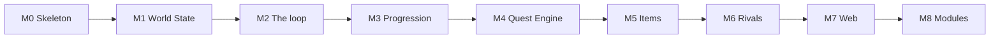

# Implementation plan — epics

**Companion to:** [`docs/plan.md`](../../plan.md) (the delivery plan) · **Baselined:** 2026-09-25
**Build model:** session-sized increments grouped into milestones; working software after every increment

One epic per milestone of the delivery plan, and, after the first build, one per release that
needs a plan of its own. Each epic turns a milestone's or a release's increments into stories with
acceptance boxes, the files and functions each story lands, the tests that prove it, the
configuration fields it introduces and the harness counters it must report. This folder holds the
open release's epic and those planned after it; the epics of finished milestones and releases, M0 to v1.2.2, are in
[`../archive/`](../archive/README.md), and each release is a row of `plan.md` §2's ledger. The
inputs the first build needed from the owner, cited in code as `INPUTS n.m`, are archived there too
([`INPUTS-REQUIRED.md`](../archive/INPUTS-REQUIRED.md)); a later epic asks its own inputs as a
table of its own.

**Who decided what.** The milestone order, the "done" bars and the ten decisions
DL-01 to DL-10 are the owner's. Everything below that — story boundaries, function names, file
layout, event names, the defaults offered for every tunable — is an agent's proposal made on
2026-09-25 from the design documents and from what the v1 proof of concept on `feature/poc`
proved to work (v1.0.1's on 2026-09-28, from the open issues and the owner's four answers in
DL-92). Nothing had been built when this plan was written; the first build has since been
completed, to `m8-modules` (the archive's *What the first build actually took*). Where a story can be done
two ways, the epic says which and why; disagree in the milestone's GitHub issue before the story
starts.

## 1. Epic register

The open release's epic, then those planned after it. A row is added when an epic is planned and moves to the archive's index
when its release closes; the release itself is recorded in `plan.md` §2's ledger.

| ID | Epic | Gate | Sessions | Depends on |
| --- | --- | --- | --- | --- |
| `v1.2.3` | [Contracts](./v1.2.3-release.md) | A full `gate`'s correctness and performance lines, the save after 20 years failing by absence; play unchanged at S1; each side's wages near `v1.2.2`'s, its fees reported (DL-312); DL-83's targets reported, not tuned; the owner's playtest, by sentence 5 | 15–19 | `v1.2.2` (DL-294, DL-311) |
| `v1.2.4` | [The economy pass](./v1.2.4-release.md) | Every line of `gate.json`, the save after 20 years included; the bands the owner approves at S1 met or accepted; each change measured alone; the owner's playtest | 10–14 | `v1.2.3` (DL-294) |

The first build's estimate, 60–78 sessions for M0 to M8, and the wall clock it actually took are in
[the archive](../archive/README.md).

A session is the unit of the estimate because it is the unit the owner has: intermittent
hours. A story that will not fit in two sessions is split before it starts, not during.

## 2. Sequence

Strictly linear. [The first build's plan](../archive/first-build-plan.md) §1 gives the reasons for the two orderings that were open: Rivals
act from M2 with one trivial disposition so nothing is ever tuned against an uncontested Board;
the module contract comes last so the pipeline's phases are settled by use before they become an
interface (ADR-0005 as amended).

Why the middle runs Progression → Quest Engine → Items → Rivals: Levels and Potential land
first and are tuned against the stub; the real
Quest Engine then has Skills and Levels to read; Items and Loot are consumed by the Quest Engine
so they follow it; Transfers are the last thing the automatic policy needs to be sensible about.

## 3. How to run a story and a release

[`docs/agents/delivery.md`](../../agents/delivery.md) (DL-218): the owner's standing rules, a story's
build, verification, record and commit, and a release's plan, close, release and record. How the first
build's milestones were run, an issue and a tag each, is kept in [the archive](../archive/README.md).

## 4. Conventions the epics assume

- Packages are `@heroesim/engine`, `@heroesim/content`, `@heroesim/words`, `@heroesim/harness`,
  `@heroesim/cli` and `@heroesim/web`, in directories of the same short name, and the tools under
  `tools/` (approach §5).
- Every tunable is a setting in `engine/src/config.json`, changed only through the content
  editor's config kind (principle 8, DL-204; `docs/agents/config.md`). Each story lists the
  settings it adds; the defaults are the agent's and are inputs the owner may change. The owner
  ratified the values in force at `m8-modules` in DL-90.
- Events are typed records `{ type, turn, participants, labels, milestone, payload }` with
  `type` in the form `<entity>.<what-happened>`: `hero.recruited`, `quest.resolved`. Each story
  lists the event types it adds.
- Engine functions never throw for a rule violation: an action returns
  `{ ok: true, document, events } | { ok: false, rejection }` with a typed `rejection`. They do
  throw on programming errors, such as an id that the validator would refuse.
- Every engine entry point takes one `deps = { config, content, modules }` object and rules
  read `deps.config`; a front end passes the document's `meta.config`, the harness passes its
  own, and `rebase` is how a game adopts new defaults (approach §3, data-model §2).
- Tests sit beside the code as `*.test.ts` and assert on events and state, never on strings.
- The vocabulary is `CONTEXT.md`, exactly, in code identifiers too: `rosterIds`, not `teamIds`.
