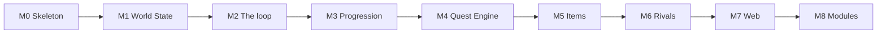

# Implementation plan — epics

**Companion to:** [`docs/plan.md`](../../plan.md) (the delivery plan) · **Baselined:** 2026-09-25
**Build model:** session-sized increments grouped into milestones; working software after every increment

One epic per milestone of the delivery plan, and, after the first build, one per release that
needs a plan of its own. Each epic turns a milestone's or a release's increments into stories with
acceptance boxes, the files and functions each story lands, the tests that prove it, the
configuration fields it introduces and the harness counters it must report. This folder holds the
open release's epic; the epics of finished milestones and releases, M0 to v1.1.7, are in
[`../archive/`](../archive/README.md), and each release is a row of `plan.md` §2's ledger. The
inputs the first build needed from the owner are gathered in
[`INPUTS-REQUIRED.md`](./INPUTS-REQUIRED.md), ordered by when they were needed, each beside the
value in force at `m8-modules` and the owner's answer.

**Who decided what.** The milestone order, the "done" bars and the ten decisions in
`plan.md` §5 are the owner's. Everything below that — story boundaries, function names, file
layout, event names, the defaults offered for every tunable — is an agent's proposal made on
2026-09-25 from the design documents and from what the v1 proof of concept on `feature/poc`
proved to work (v1.0.1's on 2026-09-28, from the open issues and the owner's four answers in
DL-92). Nothing had been built when this plan was written; the first build has since been
completed, to `m8-modules` (the archive's *What the first build actually took*). Where a story can be done
two ways, the epic says which and why; disagree in the milestone's GitHub issue before the story
starts.

## 1. Epic register

The open release's epic. A row is added when an epic is planned and moves to the archive's index
when its release closes; the release itself is recorded in `plan.md` §2's ledger.

| ID | Epic | Gate | Sessions | Depends on |
| --- | --- | --- | --- | --- |
| [v1.1.8](./v1.1.8-release.md) | The documentation slimmed: one entry map, a decision log agents can read, and the record kept once (the documentation audit of 2026-10-08) | No play changed; nothing lost, every move keeping its full text; every cited `DL-nn` an entry; the documents an agent starts from under 250 KB | 7–10 | v1.1.7 |

The first build's estimate, 60–78 sessions for M0 to M8, and the wall clock it actually took are in
[the archive](../archive/README.md).

A session is the unit of the estimate because it is the unit the owner has: intermittent
hours. A story that will not fit in two sessions is split before it starts, not during.

## 2. Sequence

Strictly linear. `plan.md` §1 gives the reasons for the two orderings that were open: Rivals
act from M2 with one trivial disposition so nothing is ever tuned against an uncontested Board;
the module contract comes last so the pipeline's phases are settled by use before they become an
interface (ADR-0005 as amended).

Why the middle runs Progression → Quest Engine → Items → Rivals: growth is the pull
(principle 2), so Levels and Potential land first and are tuned against the stub; the real
Quest Engine then has Skills and Levels to read; Items and Loot are consumed by the Quest Engine
so they follow it; Transfers are the last thing the automatic policy needs to be sensible about.

## 3. How to run a milestone

1. Open the milestone's GitHub issue with `gh issue create`, title `M<n> <name>`, body the
   epic's story list as a checklist. Not before the milestone starts.
2. Work the stories in order unless the epic says a story is independent. Each story ends with
   its tests green and, where it names one, its CLI command working on a real save.
3. Record every decision the epic left open, and every default changed, in
   `docs/decision-log.md` as a `DL-nn` entry, before or alongside the change.
4. Run the harness at the milestone's end and write the measured counters into the epic under
   a **Measured** heading, with the seed count and years.
5. Merge `v1.0-dev` into `v1.0-release`, tag that merge `m<n>-<name>`, close the issue, and
   set the status and date in the milestone table of `docs/plan.md`.

**After the first build (DL-86).** The first build ends at `m8-modules`, which is also tagged
`v1.0.0`. Work after it continues on the v1.1 line: stories are built on `v1.1-dev`, a milestone
completes by merging `v1.1-dev` into `v1.1-release` and tagging that merge, and the milestone tags
go on from `m9-random-events`. Read step 5 with those branch names. `v1.0-dev` and `v1.0-release`
are frozen but for v1.0.x hotfix releases, the first of which moves the deploy to Cloudflare
Workers (DL-88, DL-91). That release is v1.0.1, with three page fixes beside the move, planned in
[its epic](../archive/v1.0.1-release.md); it begins by fast-forwarding `v1.0-dev` to the commit that
recorded its plan, and is deployed only from a clean checkout of its tag (added 2026-09-28, DL-92).

*Amended 2026-09-29 (DL-99).* The v1.1 line's milestone is M9, the page redesigned. It carries #30
and #32 and is tagged `m9-redesign`. Random Events moves to the v1.2 line as M10
(`m10-random-events`), built on `v1.2-dev`, which is created from `v1.1-release` at `v1.1.0`. Read
step 5 with `v1.2-dev` and `v1.2-release` for it. M9's epic is
[M9-redesign.md](../archive/M9-redesign.md), in the register above (DL-100).

## 4. Conventions the epics assume

- Packages are `@heroesim/engine`, `@heroesim/content`, `@heroesim/harness`, `@heroesim/cli`,
  `@heroesim/web`, in directories of the same short name (approach §5).
- Every tunable is a field on `GameConfig` with a value in `defaultConfig` (principle 8). Each
  story lists the fields it adds; the defaults are the agent's and are inputs the owner may
  change (INPUTS-REQUIRED). The owner ratified those in force at `m8-modules` in DL-90, except
  those DL-82 to DL-89 change or leave for proposals.
- Events are typed records `{ type, turn, participants, labels, milestone, payload }` with
  `type` in the form `<entity>.<what-happened>`: `hero.recruited`, `quest.resolved`. Each story
  lists the event types it adds.
- Engine functions never throw for a rule violation: an action returns
  `{ ok: true, document, events } | { ok: false, rejection }` with a typed `rejection`. They do
  throw on programming errors, such as an id that the validator would refuse.
- Every engine entry point takes one `deps = { config, content, modules }` object and rules
  read `deps.config`; a front end passes the document's `meta.config`, the harness passes its
  own, and `rebase` is how a game adopts new defaults (approach §3, data-model §2).
- Tests sit beside the code as `*.test.ts` and assert on events and state, never on strings.
- The vocabulary is `CONTEXT.md`, exactly, in code identifiers too: `rosterIds`, not `teamIds`.
