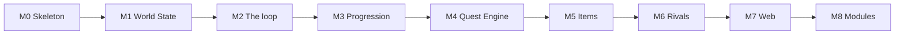

# Implementation plan — epics

**Companion to:** [`docs/plan.md`](../../plan.md) (the delivery plan) · **Baselined:** 2026-09-25
**Build model:** session-sized increments grouped into milestones; working software after every increment

One epic per milestone of the delivery plan, M0 to M8. Each epic turns a milestone's increment
list into stories with acceptance boxes, the files and functions each story lands, the tests
that prove it, the configuration fields it introduces and the harness counters it must report.
The inputs the build needs from the owner are gathered in
[`INPUTS-REQUIRED.md`](./INPUTS-REQUIRED.md), ordered by when they are needed.

**Who decided what.** The milestone order, the "done" bars and the ten decisions in
`plan.md` §5 are the owner's. Everything below that — story boundaries, function names, file
layout, event names, the defaults offered for every tunable — is an agent's proposal made on
2026-09-25 from the design documents and from what the v1 proof of concept on `feature/poc`
proved to work. Nothing has been built. Where a story can be done two ways, the epic says which
and why; disagree in the milestone's GitHub issue before the story starts.

## 1. Epic register

| ID | Epic | Gate | Sessions | Depends on |
| --- | --- | --- | --- | --- |
| [M0](./M0-skeleton.md) | Skeleton | `npm test` and `npm run lint` pass in CI; the lint rule fails a deliberate `Math.random` in `engine/`; the decision log exists | 3–4 | — |
| [M1](./M1-world-state.md) | World State | A seeded world is created, validated, saved, loaded and shown from the CLI; 1,000 worlds byte-identical across two runs | 12–14 | M0 |
| [M2](./M2-the-loop.md) | The loop | The harness plays whole games to an ending under an automatic policy; a human advances, dispatches and recruits from the CLI | 12–16 | M1 |
| [M3](./M3-progression.md) | Progression | Heroes gain Levels toward Potential and decline with age; Rankings by Fame and Wealth; Hall Improvements are bought | 6–7 | M2 |
| [M4](./M4-quest-engine.md) | Quest Engine | The stub is replaced by typed encounters and checks reading Skills, Relationship and Synergies | 7–9 | M3 |
| [M5](./M5-items.md) | Items | Gear, consumables, Market and Loot exist and are bought, sold, equipped and expended | 6–8 | M4 |
| [M6](./M6-rivals.md) | Rivals | Named dispositions; Transfers both ways; Rivals transfer among themselves | 4–6 | M5 |
| [M7](./M7-web.md) | Web | The browser front end is served from a Cloudflare Pages URL with saves in IndexedDB | 6–8 | M6 |
| [M8](./M8-modules.md) | Modules | The module contract exists and a probe module proves every part of it; the core runs with none installed, byte-identical to M7 | 4–6 | M7 |

**Total: 60–78 sessions** of two to three hours, against no calendar. That sum is stated only
here.

A session is the unit of the estimate because it is the unit the owner has: intermittent
hours. A story that will not fit in two sessions is split before it starts, not during.

## 2. Sequence

Strictly linear. `plan.md` §1 gives the reasons for the two orderings that were open: Rivals
act from M2 with one trivial disposition so nothing is ever tuned against an uncontested Board;
the module contract comes last so the pipeline's phases are settled by use before they become an
interface (ADR-0005 as amended).

Why the middle runs Progression → Quest Engine → Items → Rivals: growth is the pull
(principle 2), so Levels and Potential land first and are tuned against the stub; the real
Quest Engine then has Skills and Levels to read; Items and Loot are consumed by the Quest Engine
so they follow it; Transfers are the last thing the automatic policy needs to be sensible about.

## 3. How to run a milestone

1. Open the milestone's GitHub issue with `gh issue create`, title `M<n> <name>`, body the
   epic's story list as a checklist. Not before the milestone starts.
2. Work the stories in order unless the epic says a story is independent. Each story ends with
   its tests green and, where it names one, its CLI command working on a real save.
3. Record every decision the epic left open, and every default changed, in
   `docs/decision-log.md` as a `DL-nn` entry, before or alongside the change.
4. Run the harness at the milestone's end and write the measured counters into the epic under
   a **Measured** heading, with the seed count and years.
5. Merge `v1.0-dev` into `v1.0-release`, tag that merge `m<n>-<name>`, close the issue, and
   set the status and date in the milestone table of `docs/plan.md`.

## 4. Conventions the epics assume

- Packages are `@heroesim/engine`, `@heroesim/content`, `@heroesim/harness`, `@heroesim/cli`,
  `@heroesim/web`, in directories of the same short name (approach §5).
- Every tunable is a field on `GameConfig` with a value in `defaultConfig` (principle 8). Each
  story lists the fields it adds; the defaults are the agent's and are inputs the owner may
  change (INPUTS-REQUIRED).
- Events are typed records `{ type, turn, participants, labels, milestone, payload }` with
  `type` in the form `<entity>.<what-happened>`: `hero.recruited`, `quest.resolved`. Each story
  lists the event types it adds.
- Engine functions never throw for a rule violation: an action returns
  `{ ok: true, document, events } | { ok: false, rejection }` with a typed `rejection`. They do
  throw on programming errors, such as an id that the validator would refuse.
- Every engine entry point takes one `deps = { config, content, modules }` object and rules
  read `deps.config`; a front end passes the document's `meta.config`, the harness passes its
  own, and `rebase` is how a game adopts new defaults (approach §3, data-model §2).
- Tests sit beside the code as `*.test.ts` and assert on events and state, never on strings.
- The vocabulary is `CONTEXT.md`, exactly, in code identifiers too: `rosterIds`, not `teamIds`.
